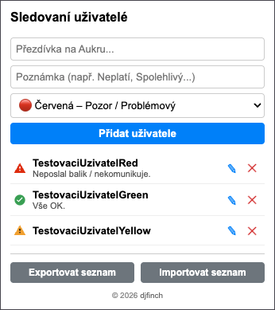
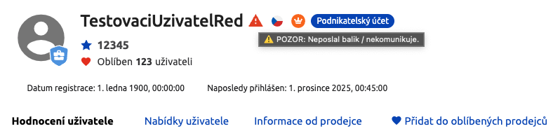
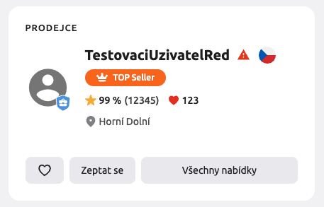

# Aukro Hlídač Uživatelů

Lehké rozšíření pro prohlížeč Google Chrome zaměřené na soukromí, určené pro web **aukro.cz**. Umožňuje udržovat vlastní seznam vybraných uživatelů s poznámkami a vizuálně je zvýrazňovat přímo na stránce.

## Ukázky

| Seznam sledovaných uživatelů | Označený uživatel na Aukru | Výsledek na stránce |
| --- | --- | --- |
|  |  |  |

## Funkce
- **Barevné výstražné značky:** Automaticky vyhledává zadané přezdívky na `aukro.cz` a přidává za ně ikonu podle zvolené kategorie (červený výstražný trojúhelník, žluté upozornění nebo zelený odznak ověřeného uživatele), která se přizpůsobí velikosti písma a nerozbíjí řádkování.
- **Vlastní poznámky a úpravy:** Ke každému uživateli lze připsat poznámku, která se zobrazí po najetí myší na ikonu. Záznamy i jejich barvu lze kdykoliv upravit.
- **Kontextové menu (pravé tlačítko myši):** Umožňuje rychle přidat označenou přezdívku nebo odkaz na profil uživatele do seznamu přímo z nabídky pravého tlačítka.
- **Dynamická ikona v liště:** Při výskytu problémového nebo sledovaného uživatele (červená/žlutá značka) na aktivní záložce se ikona rozšíření v horní liště prohlížeče změní na červený výstražný trojúhelník s počtem nálezů.
- **Zálohování a obnova:** Podporuje export a import celého seznamu včetně poznámek do lokálního souboru JSON.

## Instalace (režim pro vývojáře)
1. Stáhněte nebo naklonujte tento repozitář do svého počítače.
2. Otevřete Google Chrome a přejděte na adresu `chrome://extensions/`.
3. V pravém horním rohu zapněte přepínač **Režim pro vývojáře**.
4. Klikněte na **Načíst rozbalené** a vyberte složku projektu obsahující soubor `manifest.json`.

## Soukromí a práce s daty
- **100% lokální úložiště:** Veškeré přezdívky a poznámky se ukládají výhradně ve vašem prohlížeči pomocí `chrome.storage.sync`.
- **Žádná externí komunikace:** Rozšíření neodesílá žádná data na externí servery, nevyužívá analytiku ani rozhraní třetích stran.

## Autor a licence
Copyright © 2026 **[djfinch](https://github.com/djfinch)**  
Repozitář: [https://github.com/djfinch/aukro-hlidac](https://github.com/djfinch/aukro-hlidac)  
Tento projekt je licencován pod licencí **MIT License** – podrobnosti najdete v souboru `LICENSE`.

---

# Aukro User Watchdog

A lightweight, privacy-focused Chrome extension designed for **aukro.cz**. It allows you to maintain a local watchlist of specific usernames with custom notes and highlights them directly on the webpage.

## Features
- **Color-Coded Warning Badges:** Automatically detects specified usernames on `aukro.cz` and appends an icon based on the selected category (red warning triangle, yellow alert, or green verified badge) scaled to the surrounding font size without breaking page layout.
- **Custom Tooltip Notes & Editing:** Attach a personal note to any username (visible on hover) and edit existing entries or their badge colors anytime.
- **Right-Click Context Menu:** Quickly add any selected username or user profile link to your watchlist directly from the browser's right-click context menu.
- **Dynamic Toolbar Icon:** Changes the extension icon in the browser toolbar to a red alert triangle with a match counter badge whenever a flagged user (red/yellow) appears on the active tab.
- **Backup & Restore:** Export and import your entire watchlist and notes as a local JSON file.

## Installation (Developer Mode)
1. Download or clone this repository to your local machine.
2. Open Google Chrome and navigate to `chrome://extensions/`.
3. Enable **Developer mode** using the toggle switch in the top right corner.
4. Click **Load unpacked** and select the project folder containing `manifest.json`.

## Privacy & Data Handling
- **100% Local Storage:** All usernames and notes are stored exclusively in your browser's local sync storage via `chrome.storage.sync`.
- **Zero External Requests:** This extension does not communicate with any external servers, analytics tools, or third-party APIs.

## Author & License
Copyright © 2026 **[djfinch](https://github.com/djfinch)**  
Repository: [https://github.com/djfinch/aukro-hlidac](https://github.com/djfinch/aukro-hlidac)  
This project is licensed under the **MIT License** – see the `LICENSE` file for details.
